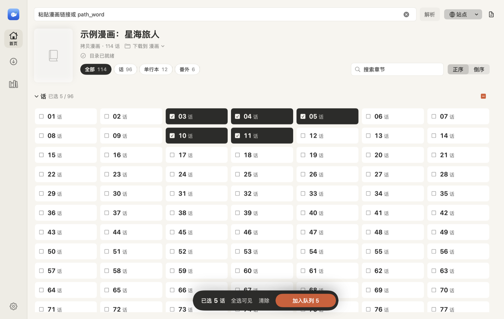
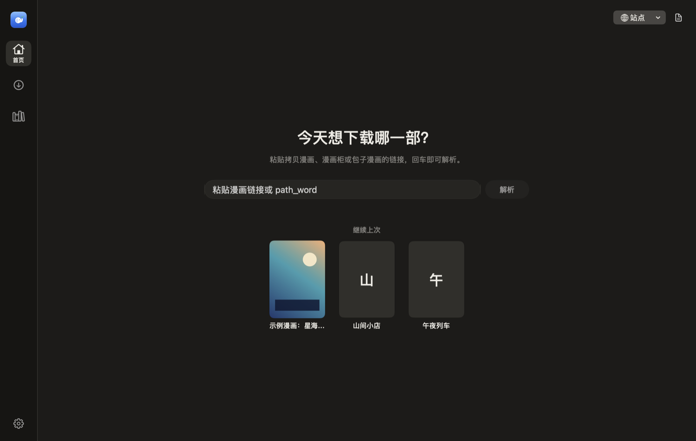
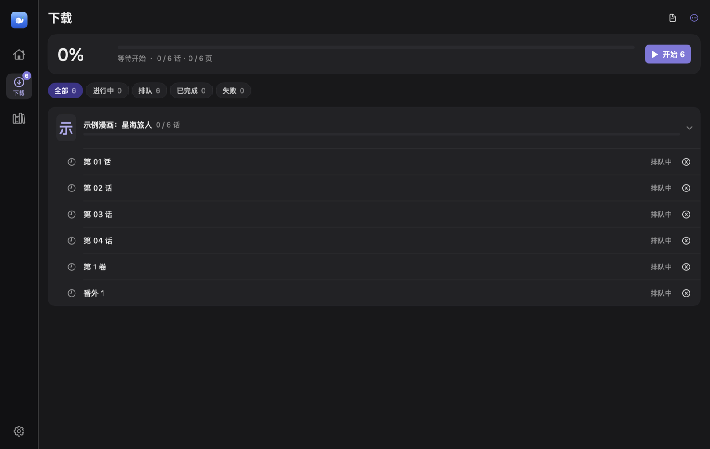
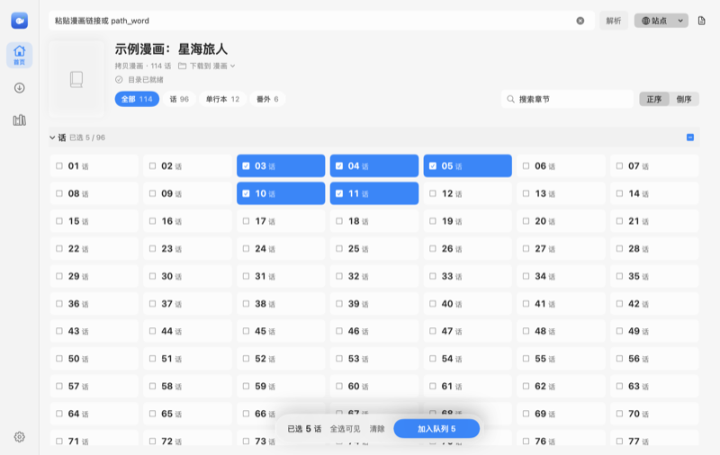
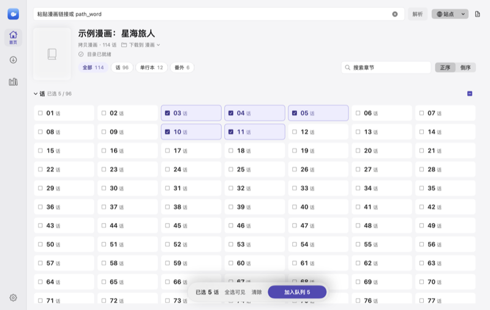

<div align="center">


# MangaGlass

**Paste a link, pick your chapters, and keep the whole series on your Mac.**

A native macOS manga downloader built with SwiftUI.

English · [简体中文](./README.zh-CN.md)

  



</div>

> The app's interface is in Chinese, because the supported sites are Chinese-language.

## Highlights

- **One step in**: paste a series link, press Return, and the cover, categories, and every chapter appear.
- **Fast selection**: click, ⇧-click for a range, ⌘-click to add, or drag a box across the grid; category chips switch views in one click.
- **Careful downloads**: bounded concurrency, request staggering, and automatic slowdown; each chapter is written to a temporary folder and only published after an integrity check.
- **Clear progress**: overall percent, speed, and time remaining at a glance, with tasks grouped by series and failure reasons one click away.
- **Pick up where you left off**: the bookshelf remembers series you've opened, and an unfinished queue is offered again after relaunch.
- **Three themes**: Classic (white and blue, frosted sidebar), Ink & Paper, and Graphite, each with light and dark variants.

## Supported sites

| Site | Domains | Notes |
| --- | --- | --- |
| CopyManga | `mangacopy.com` · `2026copy.com` · `copy4000.com` | Main, backup, and mainland mirrors; switch mirrors in one click when parsing fails |
| Manhuagui | `manhuagui.com` | Strict rate limits; downloads pause and ask you to verify in the browser when the site pushes back |
| Baozi Manga | `baozimh.com` | |

> Parsing depends on each site's current page structure. Redesigns, rate limits, or blocks can break a site temporarily.

## Screenshots

<table>
  <tr>
    <td width="50%"></td>
    <td width="50%"></td>
  </tr>
  <tr>
    <td align="center">Start · Ink &amp; Paper · dark</td>
    <td align="center">Downloads · Graphite · dark</td>
  </tr>
</table>

<table>
  <tr>
    <td width="33%"></td>
    <td width="33%"></td>
    <td width="33%"></td>
  </tr>
  <tr>
    <td align="center">Classic</td>
    <td align="center">Ink &amp; Paper</td>
    <td align="center">Graphite</td>
  </tr>
</table>

## Install

Requires macOS 13 or later and the Xcode Command Line Tools (Swift 6.2).

```bash
xcode-select --install          # if the command line tools aren't installed yet
git clone https://github.com/mraz2766/mangaglass.git
cd mangaglass
scripts/build_app.sh --install --open
```

The script builds a release binary, assembles `dist/MangaGlass.app`, copies it to `/Applications`, and opens it. Drop `--install --open` to build without installing.

## Usage

1. **Paste a link** into the field on the start screen and press Return. For CopyManga you can also enter just the `path_word` (the part after `/comic/`).

   ```text
   https://www.mangacopy.com/comic/<path_word>
   https://www.manhuagui.com/comic/<id>/
   https://www.baozimh.com/comic/<slug>
   ```

2. **Pick chapters**:
   - Click to select one, ⇧-click for a range, ⌘-click to add more.
   - Drag across empty space in the grid to box-select.
   - The square next to each volume heading selects or clears the whole volume.
   - Use the category chips to focus on one category; search and sort sit on the same row. Selected chapters that are hidden by a filter still download.

3. **Add to queue** from the floating bar at the bottom. If chapters with the same name already exist in the destination, you choose between keeping and completing them or overwriting.

4. **Track progress** on the Downloads page: start, pause, or retry failures. A system notification arrives when everything finishes.

Files are saved like this:

```text
Destination/
└── Series name/
    └── 单行本/                      # only when your selection spans more than one category
        └── 第 1 卷/
            ├── Series name-单行本-第 1 卷-0001.jpg
            └── ...
```

A chapter in progress lives in `.下载中-<chapter>` and is renamed to its final folder only after the integrity check passes.

## Settings

Open with ⌘, (MangaGlass › Settings…). Tabs: General, Downloads, Accounts & Sites.

| Setting | What it does |
| --- | --- |
| Theme / Appearance | Choose a theme, then follow the system, light, or dark; optionally use the macOS accent color |
| When closing the window | Ask, quit, or keep downloading in the background |
| Download folder | Where files go; also editable from the series header on the home screen |
| Cookie | Only needed for sign-in or restricted chapters; nothing is sent when empty |
| CopyManga image concurrency / quality | Concurrency 4–8 (default 4); uses `c1500x` high-res images and falls back to standard when needed |
| Local data | Clears the current input, parse results, and caches; downloaded files are kept |

Network requests follow your macOS system proxy settings.

## FAQ

<details>
<summary><b>No chapters show up</b></summary>

Open the same link in a browser to confirm the page loads. For CopyManga, switch mirrors when prompted. If it still fails, clear local data in Settings and try again, or open the activity log (top right) to see the exact error.
</details>

<details>
<summary><b>The browser works, but the app gets 403 or empty content</b></summary>

The site most likely expects a signed-in cookie. Copy the site's cookie from your browser's developer tools, paste it in Settings, and retry.
</details>

<details>
<summary><b>Downloads paused with a rate-limit notice</b></summary>

That's the protection kicking in: Manhuagui asks you to complete a check in the browser, and CopyManga cools down automatically. Follow the prompt and press Continue; finished chapters aren't downloaded again.
</details>

<details>
<summary><b>The Dock still shows the old icon</b></summary>

macOS caches app icons. Quit the app and open it again to refresh.
</details>

## Development

```bash
swift build                     # debug build
swift run MangaGlass            # run locally
swift test                      # unit tests
scripts/build_app.sh --install  # release build and install
scripts/build_dmg.sh            # produce dist/MangaGlass.dmg
```

UI snapshots: set `MANGAGLASS_SNAPSHOT_DIR` and run `swift test --filter LayoutSnapshots` to render every page in all three themes, light and dark, as PNGs. README screenshots come from `MANGAGLASS_README_DIR` with `--filter testRenderReadmeShowcase`.

```text
Sources/MangaGlass/
├── App/        Entry point, window behavior, main state (MainViewModel), activity log
├── Models/     Sites, series, download tasks
├── Services/   Site parsing (CopyMangaAPI), download scheduling (DownloadCoordinator), integrity checks, queue persistence
├── UI/         SwiftUI views, theme palettes, motion
└── Utils/      Network session and JSON helpers
scripts/
├── build_app.sh     Build, and optionally install, the .app
├── build_dmg.sh     Package a .dmg
└── draw_logo.swift  Vector source of the logo; regenerates every icon size
```

The version lives only in the root `VERSION` file; both build scripts read it, and `build_dmg.sh` always runs a fresh build before packaging.

Larger changes start with an execution plan in `docs/execplans/`, using the template in `.agent/PLANS.md`.

## Disclaimer

For personal learning and research only. Download only content you're allowed to access, and follow each site's terms and copyright rules.
